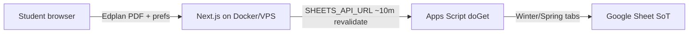

# Find My Class

Unofficial Green River College (Auburn, WA) helper: upload an **Educational Plan PDF**, set schedule preferences, and get **ranked 1st / 2nd / 3rd section & professor options** for the target quarter — plus a **conflict-free weekly schedule** with 2nd/3rd fallbacks.

> **Disclaimer:** Not affiliated with Green River College, ctcLink, the Washington SBCTC, or RateMyProfessors. Always verify sections in ctcLink before enrolling.

## Architecture



- **Spreadsheet** is the system of record ([Winter + Spring 2027 + RMP](https://docs.google.com/spreadsheets/d/13iJQzRF4nPt-ri33CZkkJs57YtpEzpR3nh8CMverTjw/edit)).
- **Apps Script** is a cached JSON bridge over denormalized term tabs (`doGet?term=2271&courses=…`).
- **Next.js** never scrapes ctcLink/RMP; it re-ranks using RMP columns on each section (confirmed match preferred; Staff/TBA + inferred ranked lower and never treated as confirmed).

## Quick start

```bash
npm install
npm run fixtures:edplan
npm test
npm run dev
```

Open [http://localhost:3000](http://localhost:3000). Without `SHEETS_API_URL`, recommendations use `fixtures/sheets-api-*.json`.

```bash
# SHEETS_API_URL=https://script.google.com/macros/s/.../exec
# optional: SHEETS_API_TOKEN if set in Apps Script properties
```

See [SHEETS_SETUP.md](./SHEETS_SETUP.md). Paste-ready Apps Script: [`docs/apps-script-paste.gs`](./docs/apps-script-paste.gs).

## Key paths

| Path | Role |
|------|------|
| `src/lib/edplan/` | PDF MIME + `%PDF` validation; AcroForm parse; course normalize |
| `src/lib/ranking/` | Preference re-rank, conflicts, schedule fallback |
| `src/lib/sheets/` | Typed Apps Script client + fixture fallback |
| `src/components/PlannerApp.tsx` | Upload → editable plan → prefs → results UI |
| `apps-script/` | clasp-ready `doGet` bridge (sync/rank stubs) |
| `docs/apps-script-paste.gs` | Single file to paste into the bound script |
| `fixtures/sheets-api-2271.json` | Demo Winter 2027 API payload |
| `SHEETS_SETUP.md` | New sheet headers, deploy, API contract |
| `DEPLOY.md` | Docker + Caddy / VPS |

## Parser acceptance (Publisher Edplan)

| Column | Term | Expected courses |
|--------|------|------------------|
| `_3` | Winter 2027 (`2271`) | ENGL 128, POLS& 202, CHEM& 161, ENGR 100 |
| `_4` | Spring 2027 (`2273`) | MATH& 152, CHEM& 162, PHYS& 221, ENGR 106 |

Codes normalize to ctcLink form (`MATH& 152`). Placeholders like `Humanities/Social Science` or bare `IP 1` are flagged **needs choice**. PDFs are processed **in memory only**.

## Tests

```bash
npm test
npm run build
```

Coverage includes: image rejection, synthetic PDF parse, confirmed vs inferred RMP, day codes (`MoWe`), conflicts, schedule fallback, preference scoring.

## Docker

```bash
docker compose up -d --build
```

See [DEPLOY.md](./DEPLOY.md). Image uses Next `output: "standalone"`.

## What works vs mocked / limited

| Piece | Status |
|-------|--------|
| Edplan PDF validate + AcroForm parse | Works (synthetic fixture in CI) |
| Preference re-rank + conflict schedule | Works against sheet JSON or fixtures |
| UI (upload → edit → results + details links) | Works |
| Apps Script source in repo | Complete; **deploy is manual** by sheet owner |
| Sheet sync / RMP scrape | Out of scope — sheet is already populated |
| Enroll deep links | Prefer `ctcLink class details link` (`class_nbr`); login often still required |
| Docker build on this authoring machine | Docker CLI may be unavailable; Dockerfile is for CI/VPS |

## Privacy

- Do **not** commit real student Edplans or IDs.
- `.gitignore` blocks `*edplan*.pdf` except `fixtures/synthetic-edplan.pdf`.
